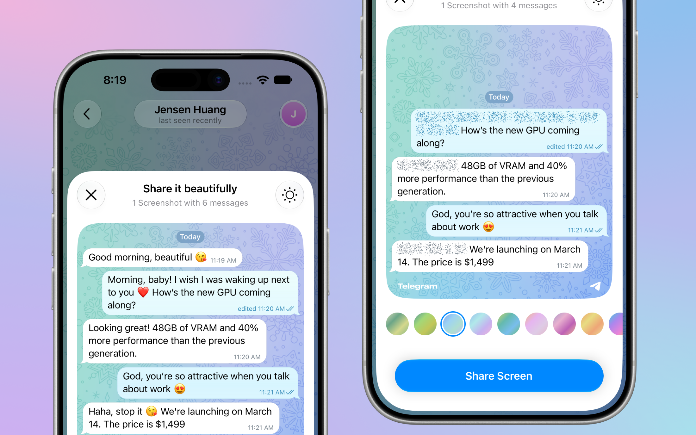

# Customize Screenshot: share a chat screenshot without what should stay private

Take a screenshot of a chat and Telegram offers to tidy it up before you share it. Remove the messages that are nobody else's
business, hide a phone number or a name inside a message, pick a nicer theme, and send the result as a clean image of the
conversation.



## Why

People share screenshots of their chats all the time: to show a friend a conversation, to ask for advice, to post something funny.
Before sending, they crop the image, scribble over names and numbers in a photo editor, or take several screenshots and send them
one by one. The scribbles are often easy to read through, and the result looks rough.

The app already knows what is on the screen. It can rebuild the screenshot from the messages themselves, let you take out what you
do not want to share, and draw it again cleanly.

## What it does

### 1. "Screenshot taken"

After a screenshot of a one-to-one chat, a notice appears at the bottom of the chat: **Screenshot taken**, "Hide messages or cut
text", with a **Customize** button. Nothing else changes: the screenshot is saved to Photos as usual, and the notice goes away by
itself after a few seconds.

**Customize** opens the editor with the messages that were on the screen at that moment.

### 2. The editor

A sheet titled **Share it beautifully**, with the number of images it will make: "1 Screenshot with 5 messages",
"2 Screenshots with 14 messages".

- **The messages are real chat bubbles,** drawn by the same code as the chat: text, emoji, reactions, replies, the time and the read
  marks, with a "Today" date header above them. The block scrolls when the messages do not fit.
- **Swipe a message to the left to remove it.** The swipe is the chat's swipe-to-reply, with a crossed-out eye instead of the reply
  arrow. The message disappears from the block and from the images.
- **Select text and choose "Cut from screenshot".** The fragment is hidden under spoiler dust. Cut the same text again to bring it
  back.
- **Themes.** The circles under the block are your own chat look first, then Telegram's chat themes. A theme changes the colours of
  the bubbles and the wallpaper with its pattern.
- **Day and night.** The sun and moon button in the header switches every theme to its dark or light variant.
- **The footer.** "Telegram" and the Telegram logo sit at the bottom of the block, in the colour of the theme's incoming bubbles, so
  the image says where it came from.
- **Fades** at the top and the bottom of the block show that there are more messages to scroll to. They appear only when a message
  is actually cut off, and they are never part of the images.

### 3. The images

The images look like real screenshots, not like a preview of one:

- They are as wide as the phone's screen and use the chat's own text size, so nothing is stretched or scaled.
- An image is as tall as its messages, at most the height of the screen. Messages that do not fit go to the next image, and the
  button says how many there are: **Share Screen** or **Share 3 Screens**.
- Each image has its own date header, the theme's wallpaper behind the messages, and the footer.
- Cut fragments are drawn as still spoiler dust. The hidden text itself is not drawn.
- No rounded corners and no fades.
- They are drawn at up to twice the screen's resolution, within the 2560 px that Telegram keeps for a photo.

### 4. Sending

**Share Screen** opens Telegram's share sheet, the same one as for forwarding a post: pick one or several chats, add a comment if
you like, send. Several images go as one album. When the sheet closes, the chat shows "Screenshot sent to Name" (or "Screenshots
sent to Name and 2 others"), in the same style as "Message forwarded to …".

## How it works

- **Noticing the screenshot.** The chat listens for the system's screenshot event while it is on screen and collects the message
  bubbles that are visible at that moment, oldest first. An album is one item.
- **The bubbles.** The editor builds ordinary chat message items for these messages, with the chosen theme, wallpaper and font size.
  A flag on the chat's interaction object tells the bubbles they are in the screenshot editor: text selection offers only "Cut from
  screenshot", spoilers do not open on a tap, the long press does not shrink the bubble and opens no message menu, and the reply
  swipe becomes the hide action.
- **Cutting text** adds a spoiler entity over the selected range to the editor's own copy of the message, then lays the bubble out
  again. The message itself is not changed.
- **The canvas.** The bubbles are laid out on a canvas as wide as the screen, the way the chat lays them out, and the block shows
  that canvas scaled down to fit the sheet. The wallpaper is always the size of the screen, as behind a real chat; the canvas only
  crops it.
- **Making the images.** For each image the canvas is set to the image's size at full scale, only that image's messages are laid
  out, and the canvas is drawn into a bitmap. A still copy of the window covers the screen meanwhile, so nothing visibly jumps. The
  spoiler dust is an animated particle layer that a snapshot does not capture, so it is drawn on top as still dots.
- **Sending.** The images go through the share sheet as external content and are sent like photos from the gallery: a small
  thumbnail and the photo itself. The share sheet used to close after external content only in the share extension; in the app it
  now closes the same way once the photos are sent.

## Applying the change

`changes.patch` is the difference from the official Telegram-iOS master at commit `24638bc69b`. From a checkout of that commit:

```
git apply --check changes.patch
git apply changes.patch
```

Then build as described in the Telegram-iOS README. The editor is a new module,
`submodules/TelegramUI/Components/PostShareImageScreen/`. The screenshot notice is in
`submodules/TelegramUI/Sources/ChatControllerOpenPostShareImage.swift`. The rest of the patch is small hooks in the chat bubbles,
the text selection menu, the swipe-to-reply node, the share sheet and the notice (`UndoUI`).
